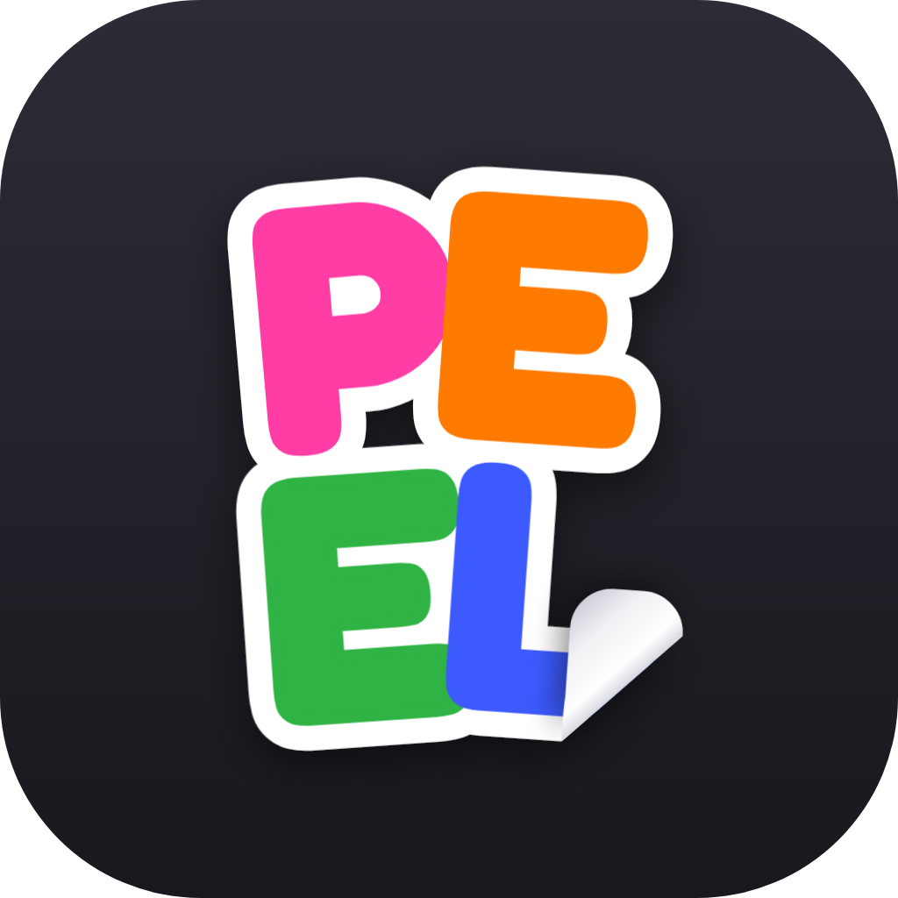

<p align="center">
  
</p>

<h1 align="center">Peel</h1>

<p align="center">
  Turn photos and videos into stickers, with sound. Free, private, on your phone.
  <br><br>
  <a href="https://github.com/shamsu07/peel/actions/workflows/ci.yml"></a>
  <a href="LICENSE"></a>
  
</p>

## What it does

- **Cut-outs in one tap.** Pick a photo; Peel finds the person, pet or
  thing, cuts it out and adds a white sticker edge.
- **Moving stickers** from any video, trimmed to WhatsApp's limits.
- **Text** in two sizes, **sound** from your voice or an audio file.
- **Packs** you can name, sent to WhatsApp or WhatsApp Business in one tap.
- **Copy** a sticker and paste it straight into a chat (moving stickers
  copy as a GIF).
- **Light and dark mode**, following your phone.

Everything happens on the device. No account, no ads, no analytics, no
uploads. See the [privacy policy](docs/store/privacy-policy.md).

## How it's built

| | |
|---|---|
| App | Flutter, Riverpod, go_router |
| Sticker encoding | [libwebp](https://chromium.googlesource.com/webm/libwebp) 1.6.0, vendored and built through Dart native-assets hooks, called over FFI |
| Native plugin | [`peel_native`](app/packages/peel_native): ML Kit and Media3 on Android, Vision and AVFoundation on iOS, generated with Pigeon |
| WhatsApp | The official third-party sticker pack integration (a ContentProvider on Android, the pasteboard on iOS) |

```
app/                 Flutter app
  lib/               Dart code: features/, sticker_engine/, whatsapp/, core/
  hook/, native/     libwebp build hook and the C shim
  packages/peel_native/  Kotlin and Swift plugin
  third_party/libwebp/   vendored libwebp (BSD)
design/brand/        icon and logo sources
docs/                spec, decisions, research, store and release guides
```

### Stickers with sound

No app can add sound to a WhatsApp sticker through WhatsApp's APIs today.
Peel prepares a short MP4 and walks you through WhatsApp's own
**Create sticker** for that last step. WhatsApp keeps up to 5 seconds of
sound for video stickers.

## Build it

You need Flutter 3.50 (stable), Xcode 26 or later for iOS, and Android SDK 36 with
NDK 28 for Android.

```bash
cd app
flutter pub get
flutter test
flutter run
```

The first build compiles libwebp for your target, which takes a minute.
Android cut-outs need Google Play services; the model downloads on first
use.

Test builds can include an on-device test lab:
`flutter run --dart-define=PEEL_LAB=true`.

Store releases: [docs/store/release.md](docs/store/release.md).

## Contributing

Issues and pull requests are welcome. Read
[CONTRIBUTING.md](CONTRIBUTING.md) first, and report security problems
privately as described in [SECURITY.md](SECURITY.md).

## Licence

Peel is [MIT licensed](LICENSE). It bundles libwebp (BSD, see
`app/third_party/libwebp/COPYING`) and fonts under the SIL Open Font
Licence (see `app/assets/google_fonts/`).

Peel isn't made by, affiliated with or endorsed by WhatsApp or Meta.
WhatsApp is a trademark of its owner.
